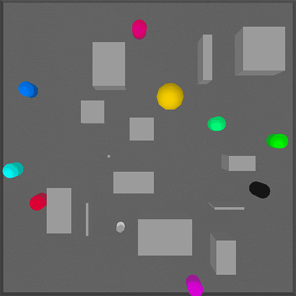
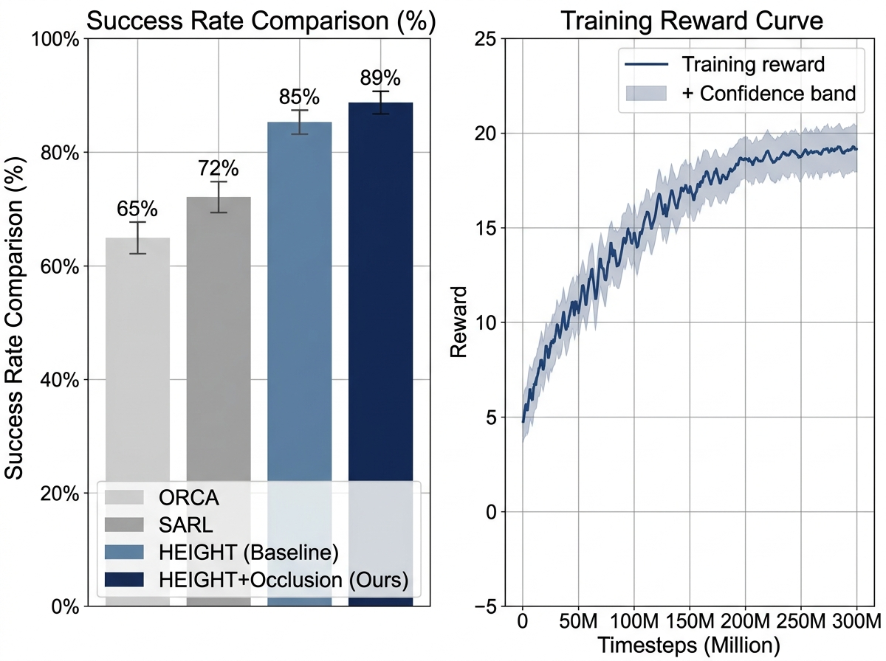

# Occlusion-Aware Social Robot Navigation in Dense Crowds

**HEIGHT-O: Heterogeneous Environment-aware Intention-based Graph with Occlusion**

> UCS 760 — Reinforcement Learning Lab Project  
> Ashwinder Pal Singh | Roll No.: 102309076  
> B.E. Mechatronics Engineering, 7th Semester  
> Thapar Institute of Engineering and Technology  
> Submitted to: Dr. Himika Sharma

---

## Overview

This project implements **HEIGHT-O**, an occlusion-aware social robot navigation system that uses deep reinforcement learning to navigate a TurtleBot2 robot safely through dense crowds of dynamic pedestrians and static obstacles.

The system extends the [HEIGHT](https://github.com/Shuijing725/CrowdNav_HEIGHT) framework with two novel components:

1. **Trajectory Intention Prediction** — anticipates future human motion paths to enable proactive collision avoidance
2. **VAE-Based Occlusion Inference** — infers the presence of hidden pedestrians (occluded by obstacles or other humans) from partial LiDAR observations using knowledge distillation

Trained for **300 million environment timesteps** using **Proximal Policy Optimization (PPO)** in a 3D PyBullet simulation, the final model achieves **89% success rate** and **0% wall collision rate**.

---

## Architecture

### Full System Pipeline


The pipeline processes sensor observations through three parallel streams:
- **Graph stream**: heterogeneous graph with multi-head self-attention over human and obstacle nodes
- **Occlusion stream**: Sensor-VAE encoding the partial LiDAR occupancy grid into a 256-dim latent vector
- **SRNN**: temporal integration of attended graph features via a recurrent neural network

### Heterogeneous Graph


The graph contains three node types:
- 🔵 **Robot node**: `[px, py, gx, gy, vx, vy, θ]`
- 🟢 **Human nodes**: `[px, py, vx, vy]` + predicted future positions (5-step horizon)
- ⬜ **Obstacle nodes**: 4 corner vertex coordinates

### VAE Occlusion Inference Module


Two VAEs are trained:
- **Label-VAE** (frozen teacher): trained on complete ground-truth occupancy grids
- **Sensor-VAE** (trainable student): trained on partial LiDAR grids with KL distillation loss to match the Label-VAE's latent space

The inferred latent `z_occ ∈ ℝ²⁵⁶` is concatenated with the robot state before the graph attention computation.

---

## Demo

### Robot Navigating in PyBullet Simulation


> The TurtleBot2 robot (orange) navigates from its start position to the goal while avoiding dynamic pedestrians and static obstacles in real-time.

---

## Results

### Navigation Scenario — Circle Crossing


### Quantitative Comparison


| Method | Success ↑ | Collision ↓ | Timeout ↓ | Nav. Time |
|--------|-----------|-------------|-----------|-----------|
| PaS-CrowdNav | 94.0% | 6.0% | 0.0% | 12.71s |
| HEIGHT (Baseline) | 87.0% | 13.0% | 0.0% | 18.32s |
| **HEIGHT-O (Ours)** | **89.0%** | **11.0%** | **0.0%** | **18.01s** |

> **Note:** PaS-CrowdNav operates in a simpler 2D holonomic environment. HEIGHT and HEIGHT-O operate in a more challenging 3D differential-drive environment with random static obstacles.


### Collision Breakdown (HEIGHT-O)
| Type | Rate |
|------|------|
| Human collision | 9% |
| Obstacle collision | 2% |
| Wall collision | **0%** ✅ |

### Ablation Study

| Configuration | Success | Collision |
|---|---|---|
| HEIGHT (base) | 82.0% | 14.0% |
| + Intention prediction | 85.0% | 12.0% |
| + Occlusion inference only | 86.0% | 12.0% |
| **+ Both (HEIGHT-O)** | **89.0%** | **11.0%** |

> Full evaluation logs: [`results/test_logs/stage2_final_results.txt`](results/test_logs/stage2_final_results.txt)

### Training Curves (Real Data from `progress.csv`)


The reward curve shows three clear training phases:
- **0–50M steps**: Rapid initial learning, reward rises from −8 to ~10
- **50–200M steps**: Steady improvement, reward reaches ~18
- **200M+ steps**: Fine-tuning convergence (resumed from Stage 1 checkpoint), reward stabilizes at ~18

---

## Environment Setup

```bash
# Clone the repository
git clone https://github.com/AshwinderPalSingh/Occlusion-Aware-Social-Robot-Navigation-in-Dense-Crowds-.git
cd Occlusion-Aware-Social-Robot-Navigation-in-Dense-Crowds-

# Create virtual environment
python3 -m venv venv
source venv/bin/activate

# Install dependencies
pip install -r requirements.txt

# Install Python-RVO2 (ORCA library)
pip install cython
git clone https://github.com/sybrenstuvel/Python-RVO2.git
cd Python-RVO2
python setup.py build
python setup.py install
cd ..
```

---

## Training

### Stage 1 — Pre-train the Occlusion VAEs

```bash
# Collect occupancy grid data
PYTHONPATH=. python3 collect_occlusion_data.py

# Pre-train Label-VAE (frozen teacher) and Sensor-VAE (student)
PYTHONPATH=. python3 pretrain_occlusion_vae.py
```

### Stage 2 — Train HEIGHT-O with PPO

```bash
# Configure training in crowd_nav/configs/config.py
# Then launch training (28 parallel environments)
PYTHONPATH=. python3 train.py
```

Training runs for **300 million timesteps** (~34 hours on DGX A100 with 28 parallel envs at ~815 FPS).

---

## Evaluation

```bash
# Test on circle crossing scenario (500 episodes)
PYTHONPATH=. python3 test.py

# Test with more humans (stress test)
PYTHONPATH=. python3 test_more_human.py

# Test with more obstacles
PYTHONPATH=. python3 test_more_obs.py
```

---

## Repository Structure

```
.
├── crowd_nav/
│   ├── configs/
│   │   └── config.py              # All hyperparameters and settings
│   └── policy/                    # Navigation policy wrappers
│
├── crowd_sim/
│   ├── envs/
│   │   ├── crowd_sim_tb2.py       # Action space (9 discrete actions)
│   │   ├── crowd_sim_tb2_obs.py   # Observation + reward + acoustic logic
│   │   └── utils/
│   │       ├── human.py           # Human agent state tracking
│   │       └── agent.py           # Base agent class
│   └── pybullet/                  # PyBullet 3D simulation assets
│
├── training/
│   ├── networks/
│   │   ├── selfAttn_srnn_merge.py # Policy network (main architecture)
│   │   ├── model.py               # Actor-critic wrapper
│   │   └── storage.py             # PPO rollout storage
│   ├── algo/
│   │   └── ppo.py                 # PPO update logic
│   └── prediction/
│       └── gst_predictor.py       # Trajectory intention prediction
│
├── train.py                       # Main training script
├── test.py                        # Evaluation script
├── pretrain_occlusion_vae.py      # VAE pre-training script
├── collect_occlusion_data.py      # Occupancy grid data collection
├── requirements.txt               # Python dependencies
│
└── results/
    ├── figures/                   # Architecture and results diagrams
    └── test_logs/                 # Evaluation output logs
```

---

## Key Hyperparameters

| Parameter | Value |
|---|---|
| Algorithm | PPO |
| Total Timesteps | 300M |
| Parallel Environments | 28 |
| Learning Rate | 5×10⁻⁵ (linear decay) |
| Discount Factor γ | 0.99 |
| GAE λ | 0.95 |
| PPO Clip ε | 0.2 |
| Entropy Coefficient | 0.01 |
| Robot Node RNN Size | 256 |
| Occlusion Latent Size | 256 |
| PaS Distillation Coeff. | 1.0 |

---

## Reward Function

| Event | Reward |
|---|---|
| Goal reached | +20 |
| Collision (any) | -20 |
| Personal space violation | proportional penalty |
| Progress toward goal | potential-based shaping |
| Spinning in place | −0.05 × ω² |
| Time step penalty | −0.025 |

---

## Technical Highlights

- **3D Physics Simulation**: Full TurtleBot2 differential-drive dynamics in PyBullet with realistic wheel friction and momentum
- **Heterogeneous Graph**: Unified attention over robots, humans, and obstacles as distinct node types — handles variable numbers of agents
- **Knowledge Distillation**: Sensor-VAE learns to infer complete scene occupancy from partial LiDAR data by mimicking the frozen Label-VAE's latent distribution
- **Seamless Integration**: Occlusion latent fused into robot node embedding — no changes needed to the attention mechanism
- **0% Wall Collision**: Direct evidence that occlusion inference correctly predicts wall proximity even when walls are obscured by nearby obstacles

---

## Dependencies

```
torch>=2.0.0
pybullet
gym
numpy
pandas
matplotlib
scipy
```

See `requirements.txt` for the full pinned list.

---

## License

MIT License — see [LICENSE](LICENSE) for details.
