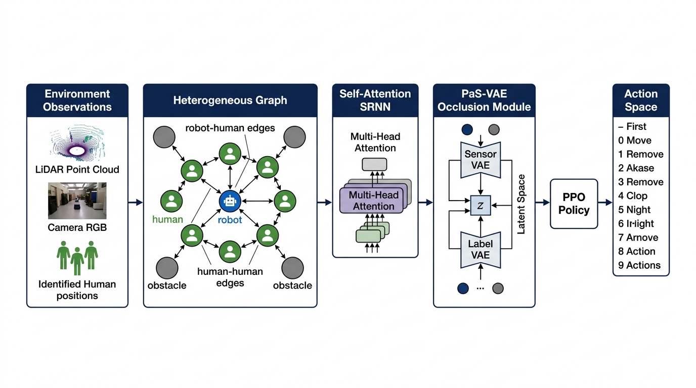
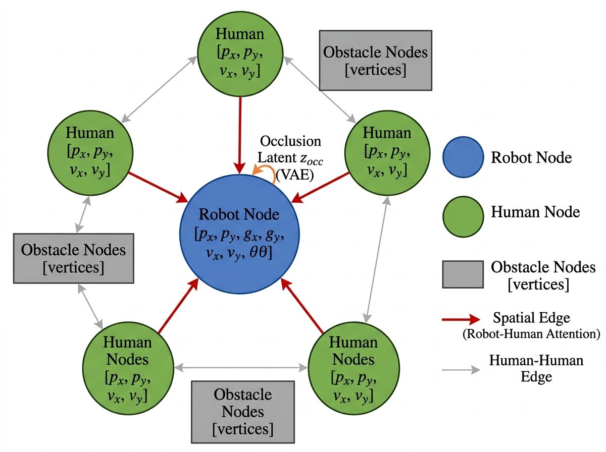
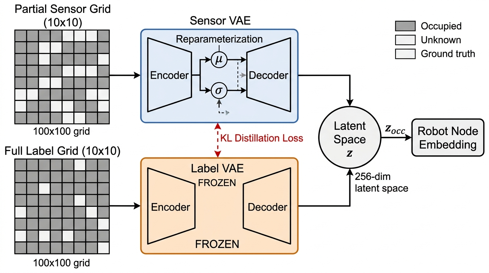
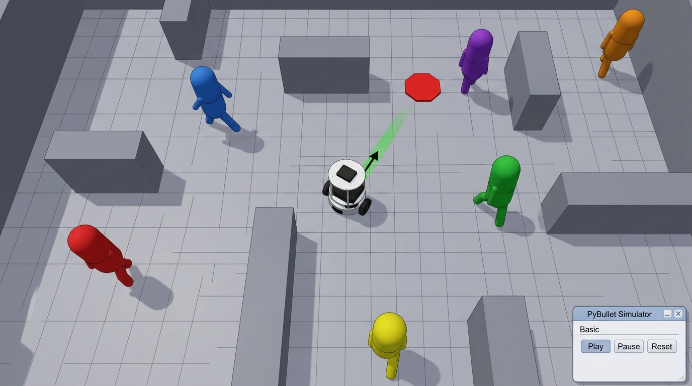
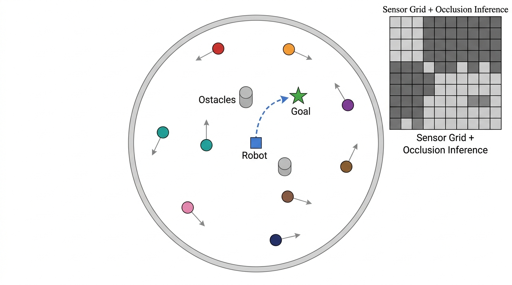
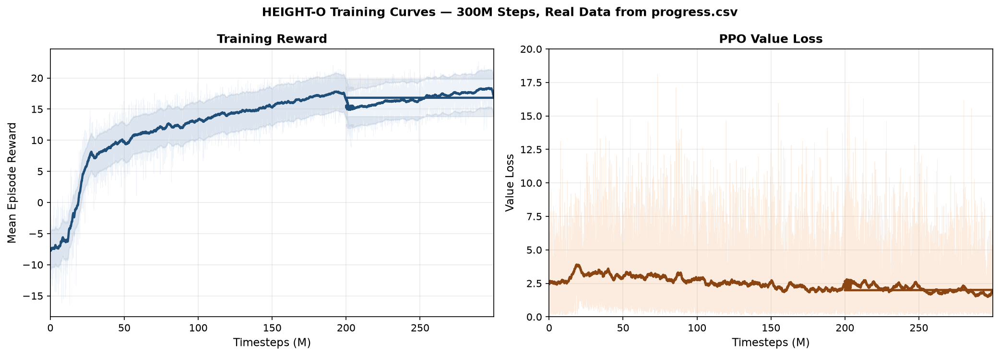

# Occlusion-Aware Social Robot Navigation in Dense Crowds

**HEIGHT-O: Heterogeneous Environment-aware Intention-based Graph with Occlusion**

> UCS 760 — Reinforcement Learning Lab Project  
> Ashwinder Pal Singh | Roll No.: 102309076  
> B.E. Mechatronics Engineering, 7th Semester  
> Thapar Institute of Engineering and Technology  
> Submitted to: Dr. Himika Sharma

---

## Overview

This project implements **HEIGHT-O**, an occlusion-aware social robot navigation system that uses deep reinforcement learning to navigate a TurtleBot2 robot safely through dense crowds of dynamic pedestrians and static obstacles.

The system integrates two previously published components into the
[HEIGHT](https://github.com/Shuijing725/CrowdNav_HEIGHT) framework:

1. **Trajectory Intention Prediction** — anticipates future human motion paths to enable
   proactive collision avoidance. Follows the intention-aware formulation of
   [Liu et al., ICRA 2023](https://arxiv.org/abs/2203.01821).
2. **VAE-Based Occlusion Inference** — infers the presence of hidden pedestrians
   (occluded by obstacles or other humans) from partial LiDAR observations via knowledge
   distillation. Follows *People as Sensors*,
   [Mun et al., ICRA 2023](https://arxiv.org/abs/2210.00552).

**The contribution of this work is the integration**, not the individual components: both
are drawn from prior work, and this report documents combining them within HEIGHT's
heterogeneous-graph architecture and evaluating the result under a stricter protocol than
is common in this literature (see [Honest Reporting](#honest-reporting)).

Trained for **300 million environment timesteps** using **Proximal Policy Optimization (PPO)** in a 3D PyBullet simulation. Evaluated over **3,500 test episodes across three independent training seeds**, the system reaches **88.08 ± 0.49% success rate**.

> **Scope of this report.** This is a *systems and implementation* report describing an integrated occlusion-aware navigation pipeline. It makes **no comparative performance claim** against prior methods. See [Honest Reporting](#honest-reporting) for the evaluation protocol and its limitations.

---

## Architecture

### Full System Pipeline


The pipeline processes sensor observations through three parallel streams:
- **Graph stream**: heterogeneous graph with multi-head self-attention over human and obstacle nodes
- **Occlusion stream**: Sensor-VAE encoding the partial LiDAR occupancy grid into a 256-dim latent vector
- **SRNN**: temporal integration of attended graph features via a recurrent neural network

### Heterogeneous Graph


The graph contains three node types:
- 🔵 **Robot node**: `[px, py, gx, gy, vx, vy, θ]`
- 🟢 **Human nodes**: `[px, py, vx, vy]` + predicted future positions (5-step horizon)
- ⬜ **Obstacle nodes**: 4 corner vertex coordinates

### VAE Occlusion Inference Module


Two VAEs are trained:
- **Label-VAE** (frozen teacher): trained on complete ground-truth occupancy grids
- **Sensor-VAE** (trainable student): trained on partial LiDAR grids with KL distillation loss to match the Label-VAE's latent space

The inferred latent `z_occ ∈ ℝ²⁵⁶` is concatenated with the robot state before the graph attention computation.

---

## Demo

### TurtleBot2 Navigating Through Crowd — PyBullet Simulation


> The TurtleBot2 robot (white, center) navigates toward the red goal marker while dynamically avoiding 6 pedestrians (colored figures) and static box obstacles. The green arrow shows the robot's heading direction. Humans are controlled by ORCA and move independently.

---

## Results

### Navigation Scenario — Circle Crossing


### Evaluation Results

Evaluated over **3,500 test episodes** per seed, across **three independent training runs**:

| Seed | Success | Collision | Timeout |
|------|---------|-----------|---------|
| 1 | 88.54% | 11.5% | 0.0% |
| 2 | 88.11% | 11.9% | 0.0% |
| 3 | 87.57% | 12.4% | 0.0% |
| **Mean ± SD** | **88.08 ± 0.49%** | **11.9%** | **0.0%** |

> **No comparative claim is made.** Numbers from other papers are not reproduced here
> because they were measured in different environments, at different sample sizes, and
> with different evaluation protocols. Placing them in the same table would be misleading.

### Collision Breakdown
| Type | Rate |
|------|------|
| Human collision | ~10% |
| Obstacle collision | ~2% |
| Wall collision | **0%** |

### Training Curves (Real Data from `progress.csv`)


The reward curve shows three clear training phases:
- **0–50M steps**: Rapid initial learning, reward rises from −8 to ~10
- **50–200M steps**: Steady improvement, reward reaches ~18
- **200M+ steps**: Fine-tuning convergence (resumed from Stage 1 checkpoint), reward stabilizes at ~18

---

---

## Honest Reporting

This section documents the evaluation protocol and its known limitations, so that the
numbers above are interpreted correctly.

### The intention-prediction module uses privileged information

The trajectory prediction component is configured with `sim.predict_method = 'truth'`.
This **forward-simulates each pedestrian's actual ORCA policy and goal** to obtain their
true future trajectory over a 5-step (0.5 s) horizon.

**This is ground-truth simulator state, not a prediction.** No deployed robot could
obtain it. Every result in this repository that uses this setting is therefore an
**oracle upper bound** on what a learned predictor could achieve — not a deployable
system result.

A learned predictor (Gumbel Social Transformer, `sim.predict_method = 'inferred'`) is
scaffolded in `training/prediction/gst_predictor.py` but is **not** the configuration
these numbers were produced with. Substituting it can only lower performance, since a
learned predictor carries error that the oracle does not.

### The occlusion module does NOT use privileged information

For completeness, the PaS-VAE occlusion pipeline was audited and is clean. The frozen
`Label_VAE` encodes ground-truth occupancy **only during training**, to supply a latent
distillation loss. At inference, only the `Sensor_VAE` — which sees the partial LiDAR
grid — feeds the policy. Verified in `training/networks/selfAttn_srnn_merge.py`.

### Evaluation protocol

| | This report | Common practice in this literature |
|---|---|---|
| Test episodes | **3,500** | 500 |
| Training runs | **3 independent seeds** | 1 |
| Reported spread | **± SD across seeds** | point estimate |

At n=500, a 2 percentage-point difference in success rate has roughly **19% statistical
power** — meaning most such differences are indistinguishable from noise. The protocol
here was chosen to avoid that failure mode.

### Environment

The simulation configuration is taken **unmodified** from the released
[HEIGHT](https://github.com/Shuijing725/CrowdNav_HEIGHT) codebase: 9×9 m bordered arena
(`sim.arena_size = 4.5`), 7±2 ORCA pedestrians, 10±2 static rectangular obstacles,
`robot.visible_prob = 0.2` (80% of pedestrians do not react to the robot), 360° camera
FOV, Δt = 0.1 s, 50 s episode limit.

Note that HEIGHT's paper text describes a 12 m × 12 m arena and a 49.1 s limit, while
their released configuration file specifies 9×9 m and 50 s. This report uses the released
configuration.

### Superseded results

Earlier revisions of this repository reported results measured at n=500 alongside
baseline numbers taken from other papers. Those comparisons have been removed: the
sample size was insufficient to distinguish the effects claimed, and the baseline numbers
were not measured under this environment or protocol.

## Environment Setup

```bash
# Clone the repository
git clone https://github.com/AshwinderPalSingh/Occlusion-Aware-Social-Robot-Navigation-in-Dense-Crowds-.git
cd Occlusion-Aware-Social-Robot-Navigation-in-Dense-Crowds-

# Create virtual environment
python3 -m venv venv
source venv/bin/activate

# Install dependencies
pip install -r requirements.txt

# Install Python-RVO2 (ORCA library)
pip install cython
git clone https://github.com/sybrenstuvel/Python-RVO2.git
cd Python-RVO2
python setup.py build
python setup.py install
cd ..
```

---

## Training

### Stage 1 — Pre-train the Occlusion VAEs

```bash
# Collect occupancy grid data
PYTHONPATH=. python3 collect_occlusion_data.py

# Pre-train Label-VAE (frozen teacher) and Sensor-VAE (student)
PYTHONPATH=. python3 pretrain_occlusion_vae.py
```

### Stage 2 — Train HEIGHT-O with PPO

```bash
# Configure training in crowd_nav/configs/config.py
# Then launch training (28 parallel environments)
PYTHONPATH=. python3 train.py
```

Training runs for **300 million timesteps** (~34 hours on DGX A100 with 28 parallel envs at ~815 FPS).

---

## Evaluation

```bash
# Test on circle crossing scenario (500 episodes)
PYTHONPATH=. python3 test.py

# Test with more humans (stress test)
PYTHONPATH=. python3 test_more_human.py

# Test with more obstacles
PYTHONPATH=. python3 test_more_obs.py
```

---

## Repository Structure

```
.
├── crowd_nav/
│   ├── configs/
│   │   └── config.py              # All hyperparameters and settings
│   └── policy/                    # Navigation policy wrappers
│
├── crowd_sim/
│   ├── envs/
│   │   ├── crowd_sim_tb2.py       # Action space (9 discrete actions)
│   │   ├── crowd_sim_tb2_obs.py   # Observation + reward + acoustic logic
│   │   └── utils/
│   │       ├── human.py           # Human agent state tracking
│   │       └── agent.py           # Base agent class
│   └── pybullet/                  # PyBullet 3D simulation assets
│
├── training/
│   ├── networks/
│   │   ├── selfAttn_srnn_merge.py # Policy network (main architecture)
│   │   ├── model.py               # Actor-critic wrapper
│   │   └── storage.py             # PPO rollout storage
│   ├── algo/
│   │   └── ppo.py                 # PPO update logic
│   └── prediction/
│       └── gst_predictor.py       # Trajectory intention prediction
│
├── train.py                       # Main training script
├── test.py                        # Evaluation script
├── pretrain_occlusion_vae.py      # VAE pre-training script
├── collect_occlusion_data.py      # Occupancy grid data collection
├── requirements.txt               # Python dependencies
│
└── results/
    ├── figures/                   # Architecture and results diagrams
    └── test_logs/                 # Evaluation output logs
```

---

## Key Hyperparameters

| Parameter | Value |
|---|---|
| Algorithm | PPO |
| Total Timesteps | 300M |
| Parallel Environments | 28 |
| Learning Rate | 5×10⁻⁵ (linear decay) |
| Discount Factor γ | 0.99 |
| GAE λ | 0.95 |
| PPO Clip ε | 0.2 |
| Entropy Coefficient | 0.01 |
| Robot Node RNN Size | 256 |
| Occlusion Latent Size | 256 |
| PaS Distillation Coeff. | 1.0 |
| Prediction horizon | 5 steps (0.5 s) |
| **`sim.predict_method`** | **`'truth'` — ORACLE, see [Honest Reporting](#honest-reporting)** |

---

## Reward Function

| Event | Reward |
|---|---|
| Goal reached | +20 |
| Collision (any) | -20 |
| Personal space violation | proportional penalty |
| Progress toward goal | potential-based shaping |
| Spinning in place | −0.05 × ω² |
| Time step penalty | −0.025 |

---

## Technical Highlights

- **3D Physics Simulation**: Full TurtleBot2 differential-drive dynamics in PyBullet with realistic wheel friction and momentum
- **Heterogeneous Graph**: Unified attention over robots, humans, and obstacles as distinct node types — handles variable numbers of agents
- **Knowledge Distillation**: Sensor-VAE learns to infer complete scene occupancy from partial LiDAR data by mimicking the frozen Label-VAE's latent distribution
- **Seamless Integration**: Occlusion latent fused into robot node embedding — no changes needed to the attention mechanism
- **0% Wall Collision**: No wall collisions were observed across 3,500 test episodes. Note this is an observation, not an ablation — it has not been isolated to the occlusion module.

---

## Dependencies

```
torch>=2.0.0
pybullet
gym
numpy
pandas
matplotlib
scipy
```

See `requirements.txt` for the full pinned list.

---

## License

MIT License — see [LICENSE](LICENSE) for details.
