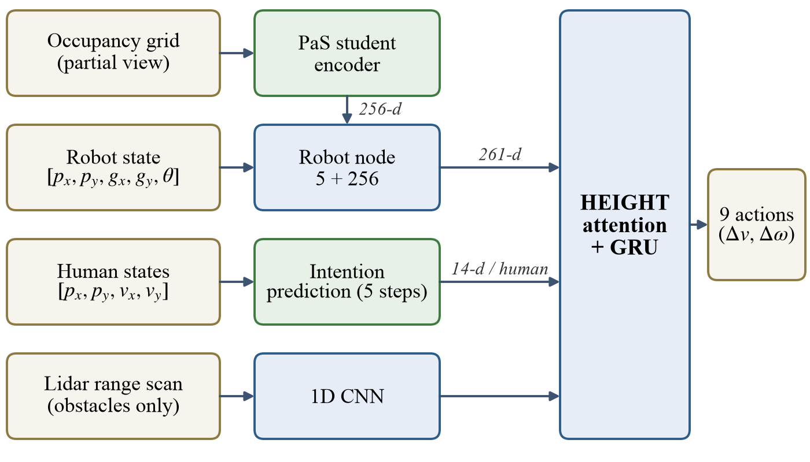

# Occlusion-Aware Social Robot Navigation in Dense Crowds

> UCS 760 — Reinforcement Learning Lab Project  
> Ashwinder Pal Singh | Roll No.: 102309076  
> B.E. Mechatronics Engineering, 7th Semester  
> Thapar Institute of Engineering and Technology  
> Submitted to: Dr. Himika Sharma

---

## Overview

This repository holds the code, the exact run configurations and the evaluation logs behind
a report on integrating two published modules into
[HEIGHT](https://github.com/Shuijing725/CrowdNav_HEIGHT), a heterogeneous graph-transformer
policy for robot navigation among pedestrians and static obstacles:

1. **Trajectory intention prediction**, after
   [Liu et al., ICRA 2023](https://arxiv.org/abs/2203.01821). Here the five-step forecast of
   each pedestrian is computed by the simulator, which makes it privileged information (see
   below).
2. **Occlusion inference** with a distilled variational encoder, after *People as Sensors*,
   [Mun et al., ICRA 2023](https://arxiv.org/abs/2210.00552).

Both modules come from prior work; the integration and its evaluation are what this
repository documents. Every number below is measured over 3,500 test episodes.

## What the evaluation shows

| Question | Result |
| --- | --- |
| Does the integrated system succeed more often? | 88.08 +/- 0.49 % over three seeds against 88.03 % for HEIGHT's released checkpoint (+0.05 points, t = 0.17) |
| Does better perception help? | Perfect pedestrian state gives no gain at the default 25 m sensing range (3,099 vs 3,099 successes); +3.03 points at 3 m |
| What does move success? | Raising `robot.visible_prob` from 0.2 to 1.0 raises it from 88.54 % to 98.77 % (HEIGHT: 88.03 % to 98.89 %) |
| Who does the robot collide with? | 335 of 336 pedestrian collisions involve a pedestrian that cannot perceive the robot (base rate 82.4 %) |
| Does it keep more distance from people? | With the simulator's forecasts, 16 % fewer personal-space intrusions than the released checkpoint and 11.4 % fewer than HEIGHT fine-tuned to 350 M steps |
| And without the forecasts? | Retrained for 350 M steps without them, success is unchanged (87.03, 88.60 and 88.57 %) and the intrusion reduction is not significant (p = 0.13, 0.37, 0.51) |

Training the HEIGHT baseline 75 % longer (to 350 M steps) changes its success by -0.26
points (p = 0.74), so training length does not explain the success result either.

## Architecture



- **Robot state** `[px, py, gx, gy, theta]` (5 values).
- **Each detected pedestrian** `[px, py, vx, vy]` plus five predicted positions (14 values).
- **Lidar scan**, 180 rays, returning static obstacles only (pedestrians excluded), encoded
  by HEIGHT's 1D CNN. This is the only way obstacles reach the policy.
- **Occupancy grid**, robot-centred, 10 x 10 m at 0.1 m cells, of the pedestrians visible to
  a 360 degree ray scan, with cells hidden behind the first object on each ray marked
  unknown. The **Sensor_VAE** (student) encodes it into a 256-dimensional latent that is
  appended to the robot state, giving a 261-dimensional robot node.
- The **Label_VAE** (teacher) is pretrained on ground-truth grids and frozen; during
  training it supplies the target of an MSE distillation loss (coefficient 1.0). It is
  never used at test time.
- HEIGHT's attention layers and recurrent robot-node network are unchanged and select one
  of nine `(delta v, delta omega)` acceleration actions.

### The forecasts are privileged

`sim.predict_method = 'truth'` rolls each pedestrian's own ORCA policy and goal forward
five steps (0.5 s) inside the simulator, without the robot, so the forecast is exact only
for pedestrians that ignore the robot. No deployed robot has this, and every result that
uses it is oracle-assisted. The `exp_nopredict_s*` runs repeat the system with
`sim.predict_method = 'none'`. A learned predictor is scaffolded in
`training/prediction/` but was not used for any result here.

## Repository layout

```
crowd_nav/configs/config.py   configuration of the reported system (the seed-1 fine-tune)
configs/runs/<run>/config.py  configuration snapshot of every run behind the report
crowd_sim/                    HEIGHT's PyBullet environment, with the occupancy grid and forecasts
training/                     policy network, PPO, occlusion VAEs, evaluation harness
train.py, test.py             training and evaluation entry points
collect_occlusion_data.py     collects occupancy grids from random-action episodes
pretrain_occlusion_vae.py     pretrains the Label_VAE teacher
set_config_value.py           changes one key in a configuration snapshot
results/logs/                 primary evaluation and training logs, per-episode JSON files
results/figures/              architecture figure and training curves
results/superseded/           early n = 500 outputs, kept for the record only
CHECKPOINTS.md                the checkpoint behind each result, with its MD5
figures/                      HEIGHT's own demo animations, from the original repository
```

## Runs

| Run | What it is | Environment steps |
| --- | --- | --- |
| `stage2_HEIGHT_intention_occlusion` | our system from scratch: 76 M steps, then a relaunch that reset the optimizer, learning-rate schedule and step counter and ran a full 300 M-step schedule | about 376 M |
| `exp_nospeak_s1`, `_s2`, `_s3` | one 50 M-step fine-tune of that checkpoint per seed; these are the three seeds above | about 426 M in total each |
| `exp_oracle_s1` | seed 1 evaluated with perfect pedestrian state (`sim.oracle_visibility = True`) | evaluation only |
| `exp_heightpub` | HEIGHT's released checkpoint evaluated in this codebase, our modules disabled | 199.8 M (released) |
| `exp_heightft` | HEIGHT's released checkpoint fine-tuned for a further 150 M steps | 350 M |
| `exp_nopredict_s1`, `_s2`, `_s3` | our system retrained from scratch with `sim.predict_method = 'none'` | 350 M each |

The three seeds share the Stage-2 initialisation and differ only in the final fine-tune,
so their spread describes that segment, not the whole training recipe. The Stage-2
snapshot is the configuration as last written in that run; `stage2_train_log.txt` shows the
update counter across its restarts. The reciprocity sweep and the sensing-range test
re-evaluate the seed-1 checkpoint with one key changed in a copy of its snapshot:
`robot.visible_prob` for the sweep, `lidar.sensor_range` and `sim.oracle_visibility` for the
range test.

## Logs

| Result | Files in `results/logs/` |
| --- | --- |
| Success and collision rates of the three seeds and of HEIGHT | `eval_exp_nospeak_s{1,2,3}.log`, `eval_heightpub.log` |
| Perception at 25 m and 3 m | `rc_rc25_{occl,oracle}.log`, `rc_rc3_{occl,oracle}.log` |
| Reciprocity sweep | `re_vp{02,04,06,08,10}_{ours,height}.log` |
| n = 1,000 pilot at the default setting | `rp_vp02_{ours,height}.log` |
| Collision analysis (336 pedestrian collisions) | `collision_taxonomy_n3500.log` |
| Intrusions | `intrusion_test_re_vp02_{ours,height}.json`, `re_vp02_{ours,height}.log` |
| HEIGHT fine-tuned to 350 M | `eval_exp_heightft.log`, `intrusion_test_exp_heightft.json`, `exp_heightft_train.log` |
| Retrain without forecasts | `eval_exp_nopredict_s{1,2,3}.log`, `intrusion_test_exp_nopredict_s{1,2,3}.json`, `exp_nopredict_s{1,2,3}_train.log` |
| Training history | `stage2_1_collect.log`, `stage2_2_pretrain.log`, `stage2_3_train.log`, `stage2_train_log.txt`, `exp_nospeak_s{1,2,3}_train.log` |

Each evaluation log ends with a summary of success, collision and timeout counts. The
JSON files hold one intrusion ratio per episode, so the intrusion comparisons can be
recomputed without a GPU:

```python
import json
ours   = json.load(open('results/logs/intrusion_test_re_vp02_ours.json'))['too_close_ratios']
height = json.load(open('results/logs/intrusion_test_re_vp02_height.json'))['too_close_ratios']
# Welch's t-test on these two arrays gives the 16 % comparison
```

`MANIFEST.md5` lists a checksum for every log. All are unchanged copies of the archived
logs; only `collision_taxonomy_n3500.log` was renamed. Two things to know when reading
them:

- The **path length** in the summaries is not a real distance (see Known issues); the
  report does not use it.
- In `collision_taxonomy_n3500.log`, the heading-change percentages in section F are shares
  of the 133 collisions in which a heading change was detected. As shares of all 336
  collisions they are 7.1, 15.5, 20.8 and 23.8 % within 0.5, 1, 2 and 3 s.

## Reproducing

Setup, as for HEIGHT:

```bash
python3 -m venv venv && source venv/bin/activate
pip install -r requirements.txt
pip install cython
git clone https://github.com/sybrenstuvel/Python-RVO2.git
cd Python-RVO2 && python setup.py build && python setup.py install && cd ..
```

1. **Collect occupancy grids** from random-action episodes (1,000 for training, 100 for
   validation): `python3 collect_occlusion_data.py`
2. **Pretrain the teacher** for 300 epochs, which writes
   `data/occlusion_vae/label_vae_ckpt/label_vae_weight_300.pth`:
   `python3 pretrain_occlusion_vae.py`
3. **Train** with `python3 train.py`, which reads `crowd_nav/configs/config.py`. The file
   shipped is the seed-1 fine-tune, which resumes from
   `data/exp_nospeak_s1/checkpoints/000000.pt`. To train from scratch instead, set
   `training.resume = 'none'`, and set `training.num_env_steps` and `training.output_dir`
   for the run you want. Training writes a copy of its configuration into the run
   directory.
4. **Evaluate** a run directory with
   `python3 test.py --model_dir data/<run> --test_model <checkpoint>.pt`. Evaluation uses
   the configuration stored in that directory and runs `env.test_size` episodes (3,500 in
   every snapshot here).

Training used 28 parallel environments and 30 steps per rollout (840 environment steps
per update), PPO with learning rate 5e-5 and linear decay, gamma 0.99, GAE lambda 0.95,
clip 0.2 and entropy coefficient 0.01. A 50 M-step fine-tune took about 17 hours on one
A100 at roughly 829 environment steps per second.

## Known issues

These were found after the experiments had run. The code here is the code that produced
the results, so none of them is patched.

- **Path length.** The vectorised environment resets inside `step()` when an episode
  ends, so on the last step the evaluator reads the next episode's start position. The
  path-length metric (inherited from HEIGHT's evaluator) therefore includes the jump to
  the next start, about 4 m per episode. Episode-worst separation and intrusion depth also
  include one sample of the next episode. Outcome counts, navigation time and the
  intrusion ratio are not affected.
- **One-step lag.** The environment reads the robot pose before the physics step and
  moves the pedestrians first, so each observation pairs the robot at time t with
  pedestrians at t + 1. This is HEIGHT's own ordering.
- **Batch normalisation.** Evaluation never switches the model to evaluation mode, so the
  occlusion encoder's batch normalisation uses batch statistics at test time, as it did
  during training rollouts. The frozen teacher's batch-norm statistics were not frozen
  either. HEIGHT itself has no batch normalisation.
- **Latent re-sampling.** The occlusion latent is sampled again when PPO re-evaluates
  actions, so the policy-update ratio carries sampling noise.
- **Short-range grid.** Rays that hit nothing mark cells free out to the grid's edge
  rather than to the sensor range, so at 3 m the grid shows unsensed cells as free. This
  affects only the 3 m perception test.
- **Resume.** A resumed run repeats the update it resumed from (840 environment steps for
  `exp_nopredict_s2`, which was resumed from update 245,200 after a storage failure).
- **Timeouts.** Episodes time out after 491 steps (49.1 s), because `env.time_limit = 50`
  ends an episode once `global_time >= time_limit - 1`.

## Superseded material

`results/superseded/` keeps earlier outputs for the record: evaluations of intermediate
checkpoints at n = 500, a summary written before the final protocol
(`stage2_final_results.txt`, which still reports a 300 M-step budget and independent seeds),
and an early pipeline test in `height_test_results/` that is unrelated to the reported
system. None of it is used in the report.

## Environment

The simulation settings are HEIGHT's released configuration: a 12 x 12 m walled arena with
start, goal and spawn positions drawn mostly from its central 9 x 9 m, 7 +/- 2 moving ORCA
pedestrians plus 0 to 2 standing ones, 10 +/- 2 static rectangular obstacles, and
`robot.visible_prob = 0.2`, under which each moving pedestrian has a 20 % chance of
perceiving the robot and standing ones never do (17.6 % of pedestrians on average). The
robot is a differential-drive TurtleBot2 with commanded speed up to 0.5 m/s (the wheel-speed
limit caps straight-line speed near 0.40 m/s), a 360 degree view and a 25 m lidar, at a
0.1 s time step.

## References

- S. Liu et al., "HEIGHT: Heterogeneous interaction graph transformer for robot navigation
  in crowded and constrained environments," IEEE Transactions on Automation Science and
  Engineering, 2026. Code: https://github.com/Shuijing725/CrowdNav_HEIGHT
- Y.-J. Mun, M. Itkina, S. Liu and K. Driggs-Campbell, "Occlusion-aware crowd navigation
  using people as sensors," ICRA 2023.
- S. Liu et al., "Intention aware robot crowd navigation with attention-based interaction
  graph," ICRA 2023.

## License

MIT License; see [LICENSE](LICENSE). The HEIGHT codebase this builds on is MIT-licensed by
its authors, and their notice is preserved.
